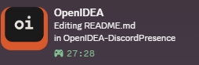

# Discord Presence for OpenIDEA

Shows what you are working on in OpenIDEA as your Discord activity: the file, its language, the project and (optionally) the branch, with the time elapsed.





It talks to the Discord desktop app on the same computer through Discord's local socket (Rich Presence over IPC). Nothing goes over the network from the plugin, and the browser version of Discord can't be reached.

## Settings

Settings › Plugins › Discord Presence:

| Setting | Default | |
| --- | --- | --- |
| Show my activity on Discord | on | Also toggled by clicking the **Discord** status bar item or **Discord Presence: Turn On/Off**. |
| First / second line while editing | `Editing {file}` / `in {project}` | Placeholders `{file}`, `{language}`, `{project}`, `{branch}`. Remove a placeholder to keep it private. |
| First / second line with no file open | `Browsing {project}` / empty | |
| Elapsed time | `session` | `session` (reset after 30 minutes away), `file`, or `none`. |
| Hide after minutes without editor activity | 5 | Focusing an editor, opening or saving a file, or a VCS change counts as activity. `0`: never. |
| Language logo | on | The language's logo (62 of them, for about 80 languages), with the OpenIDEA logo in the corner. Off, or a language without a logo: the OpenIDEA logo. |

**Discord Presence: Reconnect** connects again right away (otherwise a failed connection is retried every 30 seconds, for example when Discord starts after the IDE).

## Permissions

| Permission | Why |
| --- | --- |
| `ipc:\\.\pipe\discord-ipc-*` (Windows), `ipc:$XDG_RUNTIME_DIR/…`, `ipc:$TMPDIR/…`, `ipc:/tmp/…` (Linux incl. Flatpak and Snap, macOS) | The Discord app's local socket. Only paths named `discord-ipc-N`. |
| `events` | Knowing which file is focused. |
| `project.read` | The project's folder name. |
| `storage` | Session start time, the socket that worked last, on/off. |
| `vcs.read` (optional) | `{branch}`. |

## Limits

- With several OpenIDEA windows open, the presence follows the window you worked in last (focused or opened a file there). Saves and VCS changes in the other windows, such as a background fetch, don't take it over; closing that window clears the presence until the next editor event.
- The IDE stops a plugin that has had nothing to do for 5 minutes; the connection closes and Discord removes the activity. It comes back with the next editor event.
- A remote project's plugin runs on the project's server, so the presence works only when Discord runs on that machine.

## Requirements

OpenIDEA with plugin API 1.4 (0.1.40 or later) and the Discord desktop app.

## Building

```sh
cargo test
openidea-plugin build          # dist/plugin.wasm + check
openidea-plugin link           # try it in the IDE
openidea-plugin pack . --key <your.key> --publisher mrboombastic
```

## Discord art assets

`assets/` holds the images uploaded to the OpenIDEA Discord application (Developer Portal › Rich Presence › Art Assets), named by their keys. Language logos are from [Devicon](https://github.com/devicons/devicon) (MIT) and [Simple Icons](https://github.com/simple-icons/simple-icons) (CC0); `sql.png` is drawn for this plugin. The logos are trademarks of their owners.

## License

MIT
